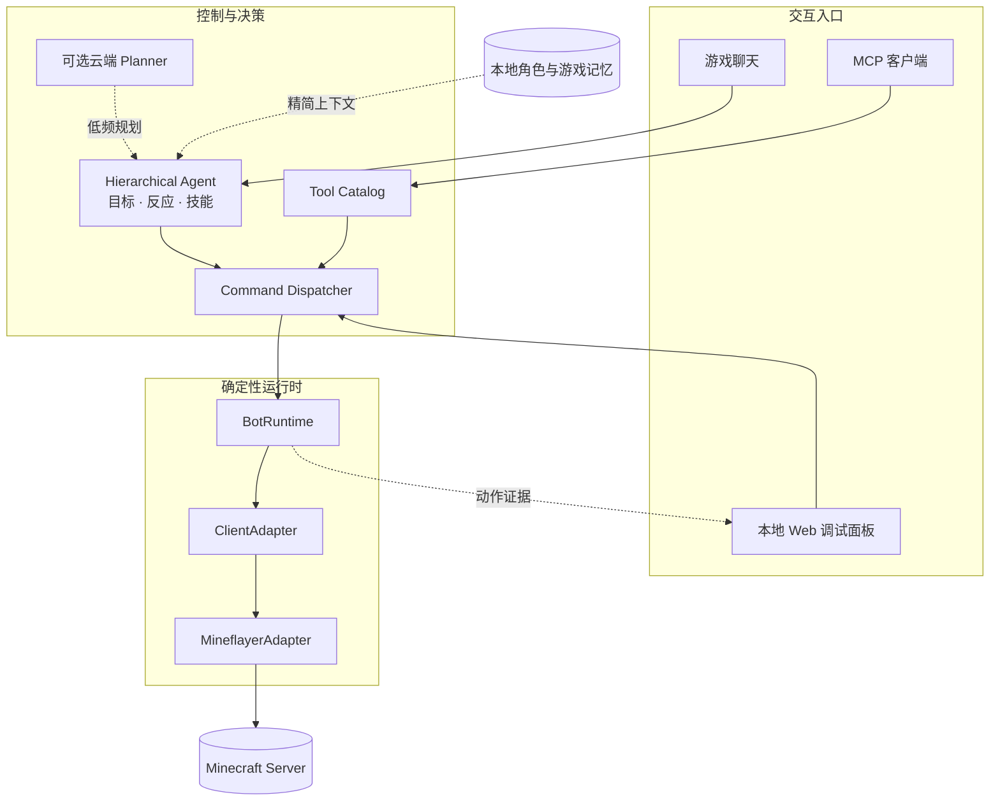

<div align="center">

# 小狸 / XiaoLi

**一个本地优先、可观察、会真实行动的 Minecraft Java 同伴 Bot。**

[](https://github.com/Moony-Irises/xiaoli/actions/workflows/moony-mcbot-ci.yml)


[快速开始](#快速开始) · [当前能力](#当前能力) · [系统架构](#系统架构) · [项目文档](#项目文档) · [路线图](#路线图)

</div>

> 小狸的目标不是只在聊天里“说自己做完了”，而是让每个决定、动作和失败都能在游戏或调试后台中找到证据。

## 这是什么

XiaoLi 是一个围绕 Minecraft Java Edition 构建的个人实验项目。当前主要模块 [`moony-mcbot/`](moony-mcbot/) 使用 TypeScript、Mineflayer、MCP 和本地 Web 调试面板，将聊天、目标、Agent 决策、游戏动作、记忆与诊断串成一条可检查的运行链。

项目采用本地优先设计：账号凭据、API key、角色记忆和运行时配置留在本机；云端模型只在需要规划或闲聊时作为可选能力接入。确定性动作优先由代码和规则执行，不要求模型直接操纵底层客户端。

**当前阶段：成熟原型，尚非稳定发行版。** 原版与协议兼容服务器使用 Mineflayer；整合包客户端 Bridge、模组 GUI 和复杂模组工序仍在规划阶段。

## 当前能力

| 领域 | 已有能力 |
| --- | --- |
| 连接与观察 | 多 Bot runtime、Yggdrasil 登录、状态/生命/背包/玩家/实体/方块快照 |
| 行动 | 聊天、跟随、定点移动、进食、开门、物品整理、一次攻击、实体对决、单块采矿 |
| 安全移动 | 跟随、追击和定点移动禁止挖路、搭路、搭柱和危险大落差；不可达时停止并留下结构化失败 |
| Agent | 战略目标、里程碑、反应规则、技能目录、可选 Planner、工具权限与执行追踪 |
| 记忆 | 玩家关系与别称、地点、聊天滚动摘要、共享记忆读取边界 |
| 调试 | MCP 工具、本地 Web 面板、Command/Action History、Adapter 最近动作、事件与状态快照 |
| 自我保护 | 低生命/饥饿信号、自动进食基础链、领地警告与受限反击状态机 |

完整工具与行为清单见 [Moony MCBot README](moony-mcbot/README.md)。

### 明确还没完成

- `ModdedClientAdapter` 目前只有接口与迁移设计，没有可连接的整合包客户端 Bridge。
- 机械动力、农夫乐事、精妙存储等模组能力尚不能稳定执行复杂工序。
- 部分真实服务器登录、断线恢复、持续寻路和危险动作仍需人工回归。
- Agent runtime 仍在收敛，旧工具编排层尚未全部迁入统一 Command / Adapter 边界。
- 项目当前没有稳定版本承诺，也没有发布为通用托管服务。

## 系统架构



核心原则：模型负责理解与拆分，代码负责校验与执行，Adapter 负责接触具体客户端，调试层负责证明实际发生了什么。

## 快速开始

### 环境要求

- Node.js 22 或 24
- npm
- 可供 Bot 登录的 Minecraft Java 账号和目标服务器

### 1. 安装

```powershell
git clone https://github.com/Moony-Irises/xiaoli.git
cd xiaoli\moony-mcbot
npm ci
```

### 2. 创建本地配置

```powershell
Copy-Item .env.local.example .env.local
```

编辑 `.env.local`，填写 Bot 登录配置；需要 AI 闲聊或规划时再填写兼容 OpenAI Chat Completions 的 API 配置。`.env.local` 已被 Git 忽略，不要把真实凭据写进 README、Issue、测试或调试动作。

### 3. 启动

```powershell
npm run dev
```

启动后打开本地调试面板：

```text
http://127.0.0.1:4637
```

服务通过 stdio 暴露 MCP 工具；也可以只使用 Web 面板完成状态查看、目标设置、常用动作和结果诊断。首次连接与完整测试流程见 [手动测试指南](moony-mcbot/docs/manual-testing-guide.md)。

## 开发验证

```powershell
cd moony-mcbot
npm run validate:releases
npm run lint
npm run typecheck
npm test
npm run build
```

CI 在 Node.js 22 与 24 上执行相同门禁。离线测试使用临时运行时目录和假凭据，不读取本机正式账号、共享记忆或 prompt profile。

## 仓库结构

```text
xiaoli/
├─ .github/workflows/       GitHub Actions
├─ moony-mcbot/
│  ├─ src/agent/            分层 Agent、事件、黑板与技能
│  ├─ src/catalog/          工具元数据与暴露策略
│  ├─ src/commands/         统一命令、结果与历史
│  ├─ src/runtime/          Bot 生命周期、状态与 ClientAdapter
│  ├─ src/tools/            MCP 工具与待迁移领域编排
│  ├─ src/debug/            本地 Web 调试面板
│  ├─ src/memory/           游戏与聊天记忆接入
│  ├─ test/                 离线测试与契约回归
│  └─ docs/                 架构、测试和迁移文档
└─ README.md                仓库入口
```

Voice、图片和跨模块共享记忆是同一工作区中的本地模块，目前不随此仓库上传。它们通过明确的数据边界共享角色上下文，密钥和实时认证状态不进入共享记忆。

## 项目文档

- [架构收敛路线图](moony-mcbot/docs/architecture-convergence-roadmap.md)
- [2026-07-31 全项目审计](moony-mcbot/docs/project-audit-2026-07-31.md)
- [手动测试指南](moony-mcbot/docs/manual-testing-guide.md)
- [整合包客户端适配方案](moony-mcbot/docs/modded-client-adapter-plan.md)
- [共享记忆规划](moony-mcbot/docs/shared-memory-plan.md)
- [Planner 上下文投影设计](moony-mcbot/docs/planner-context-projection-design.md)
- [Release Entry 生命周期](moony-mcbot/docs/release-entry-lifecycle.md)

## 路线图

1. **稳定运行时**：继续把状态所有权、定时器、队列和退出生命周期收敛到明确模块。
2. **统一执行链**：让 MCP、Web、聊天和 Agent 逐步共享 Command Dispatcher 与 Action Result。
3. **完成 Adapter 收敛**：移除上层对 Mineflayer 私有对象的直接依赖，建立可验证的 conformance 契约。
4. **整合包 Bridge MVP**：通过 Companion Mod + Local Bridge 接入真实模组客户端状态和动作。
5. **模组知识与技能包**：先识别 Mod 列表和容器能力，再实现可验证的多步骤工序。

## 安全与边界

- 默认 Web 面板只绑定 `127.0.0.1`；绑定局域网地址时必须配置认证 token。
- 真实密码、API key、token 和运行时记忆只存本地忽略文件，不进入 Git。
- 云端 Planner 只接收经过投影的必要上下文，不发送完整本地状态、事件 payload 或记忆备注。
- 本项目与 Mojang Studios、Microsoft 或 Minecraft 官方没有关联。

---

详细配置、环境变量和工具说明请继续阅读 [`moony-mcbot/README.md`](moony-mcbot/README.md)。
